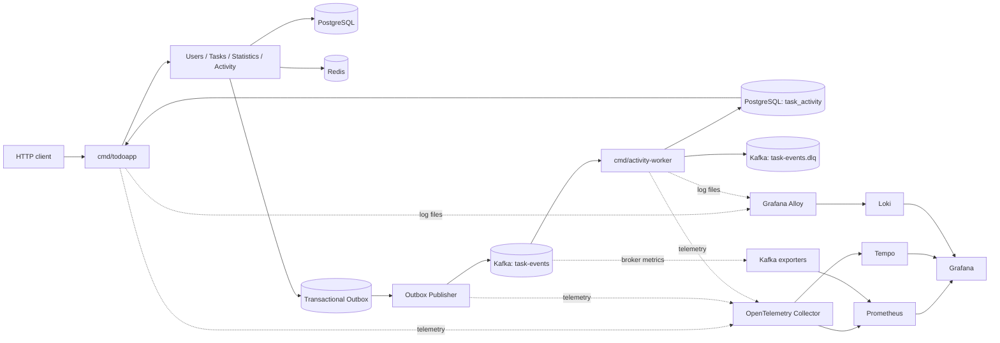

# 20h-project

A Go backend project built to explore production-oriented backend engineering: REST API design, PostgreSQL transactions, Redis caching, asynchronous event processing with Kafka, and observability.

The application manages users and tasks. Task changes are written to PostgreSQL and published asynchronously through a transactional Outbox. A separate Activity Worker consumes Kafka events and builds an auditable task history.

> The repository is a learning and portfolio project. The architecture demonstrates reliability and operational patterns, but the local Docker Compose environment is intended for development, not production deployment.

## Contents

- [Project overview](#project-overview)
- [Architecture](#architecture)
- [Task event lifecycle](#task-event-lifecycle)
- [Reliability and delivery semantics](#reliability-and-delivery-semantics)
- [Kafka cluster](#kafka-cluster)
- [REST API](#rest-api)
- [Technology stack](#technology-stack)
- [Observability](#observability)
- [Run locally](#run-locally)
- [Run with Docker Compose](#run-with-docker-compose)
- [Configuration](#configuration)
- [Testing](#testing)
- [Useful Make targets](#useful-make-targets)
- [Repository structure](#repository-structure)
- [Current scope and limitations](#current-scope-and-limitations)

## Project overview

The project consists of three executable entry points:

| Executable | Responsibility |
|---|---|
| `cmd/todoapp` | HTTP API, business features, PostgreSQL access, Redis cache, and the background Outbox Publisher |
| `cmd/activity-worker` | Kafka Consumer that validates task events and persists Activity history |
| `cmd/activity-dlq-replay` | Utility for replaying an individual message from the Activity Dead Letter Queue |

The API and Activity Worker are separate processes. They can be built, started, stopped, and scaled independently.

### Functional scope

- User management: create, read, update, and delete users.
- Task management: create, read, update, and delete tasks.
- Pagination for collection and Activity history endpoints using `limit` and `offset`.
- Filtering task lists and statistics by `user_id`.
- Statistics filtering by a date range.
- Task Activity history generated asynchronously from domain events.
- Redis cache for global, unfiltered task statistics.
- Kafka event delivery using a PostgreSQL transactional Outbox.
- Retry handling and a Dead Letter Queue for permanently invalid messages.
- Metrics, distributed traces, structured logs, and load/observability test scenarios.

## Architecture



### Main components

| Component | Role |
|---|---|
| HTTP API | Exposes the application features under `/api/v1` |
| PostgreSQL | Source of truth for users, tasks, Outbox events, and Activity history |
| Redis | Cache for global statistics; PostgreSQL remains authoritative |
| Outbox Publisher | Claims unpublished Outbox rows and publishes them to Kafka |
| Kafka | Transports task domain events between independent processes |
| Activity Worker | Consumes events and persists the task history |
| DLQ | Holds messages that cannot be processed because they are permanently invalid |
| Prometheus | Stores metrics as time series |
| OpenTelemetry Collector | Receives telemetry from the Go processes and routes it to Prometheus and Tempo |
| Tempo | Stores distributed traces |
| Grafana Alloy and Loki | Collect and store application logs |
| Grafana | Provides a common UI for metrics, traces, and logs |

## Task event lifecycle

A task mutation does not publish to Kafka directly inside the HTTP request. Instead, the application uses the Transactional Outbox pattern.

1. A request reaches the Task HTTP handler and the Task Service.
2. The Tasks Repository starts a PostgreSQL transaction.
3. The repository inserts, updates, or deletes the task.
4. It creates a versioned event envelope, such as `task.created`, `task.updated`, or `task.deleted`.
5. The event is inserted into `todoapp.outbox` using the same transaction.
6. PostgreSQL commits the task mutation and Outbox row atomically.
7. The Outbox Publisher claims eligible rows and publishes them to `task-events`.
8. After Kafka returns a successful delivery report, the Publisher marks the Outbox row as published.
9. An Activity Worker in the `activity-workers` Consumer Group receives the event, validates it, and writes it to `todoapp.task_activity`.
10. The Worker commits the Kafka offset only after the database write succeeds.

This decouples the HTTP request from Activity history processing. The API does not wait for the Activity Worker to finish.

### Event envelope

Events use a versioned envelope with fields including:

- `event_id`: unique event identifier.
- `event_type`: domain event type.
- `schema_version`: event schema version.
- `aggregate_type`, `aggregate_id`, `aggregate_version`: aggregate identity and version.
- `occurred_at`: event creation time.
- `payload`: event-specific data.

The event contract and validation are implemented in `internal/core/events`.

### Transactional Outbox

The Outbox table stores the event payload together with publishing state:

- `published_at` identifies successfully published rows.
- `next_attempt_at` controls when a failed event can be retried.
- `lease_token` and `lease_until` protect rows claimed by a Publisher.
- `attempts` and `last_error` store retry information.
- `traceparent` and `tracestate` preserve W3C trace context across the asynchronous boundary.

The claim query uses `FOR UPDATE SKIP LOCKED`, so multiple claimers do not take the same active row. It also prevents a later event for the same aggregate from being claimed while an earlier event remains unpublished.

The Publisher sends the task ID as the Kafka message key. Kafka therefore routes events for the same task using the same key and partitioning rule.

## Reliability and delivery semantics

The delivery model is **at-least-once**, not exactly-once.

A message can be published to Kafka more than once. For example, Kafka may acknowledge a message while the subsequent Outbox status update fails. Once the lease expires, the event can be published again.

The Activity side is designed to tolerate this:

- `task_activity.event_id` has a unique constraint.
- Activity insertion uses `ON CONFLICT (event_id) DO NOTHING`.
- The repository reports whether a row was inserted.
- A duplicate delivery is treated as successfully handled after the existing record is confirmed and the Kafka offset is committed.

### Retry handling

The Outbox Publisher schedules another attempt when event serialization or Kafka publication fails. Its retry delay grows exponentially up to the configured maximum.

The Activity Worker retries transient processing and offset-commit errors with exponential backoff. It pauses consumption while retrying and resumes after the operation succeeds.

Permanently invalid messages — for example malformed JSON, an invalid envelope, an unsupported event type, or an unsupported schema version — are sent to `task-events.dlq`.

The source offset is committed only after the DLQ Producer confirms successful delivery.

### DLQ replay

An individual DLQ message can be replayed by specifying its partition and offset:

```bash
make activity-dlq-replay DLQ_PARTITION=1 DLQ_OFFSET=125
```

The replay utility reads the selected DLQ record and republishes its original payload and key to the original source topic and partition. It does not silently rewrite the event.

Replaying an event can result in another delivery. The Activity repository's `event_id` uniqueness constraint protects the stored history from duplicate rows.

## Kafka cluster

The local environment runs three Apache Kafka 4.4.0 brokers in KRaft mode. Each node has both broker and controller roles; ZooKeeper is not used.

| Setting | Value |
|---|---:|
| Brokers | 3 |
| Controllers | 3 (combined with brokers) |
| Partitions per application topic | 3 |
| Replication factor | 3 |
| Minimum in-sync replicas | 2 |
| Automatic topic creation | Disabled |
| Producer acknowledgements | `acks=all` |
| Producer idempotence | Enabled |

### Topics

| Topic | Purpose | Retention |
|---|---|---:|
| `task-events` | Normal task domain events | 7 days |
| `task-events.dlq` | Permanently invalid events | 30 days |

Both topics use three partitions, replication factor three, and `min.insync.replicas=2`. Unclean leader election is disabled.

Topics are created and configured explicitly by the Makefile:

```bash
make kafka-up
make kafka-topics-setup
```

The Kafka UI is available at [http://localhost:8080](http://localhost:8080).

### Consumer scaling

The Activity Workers share the `activity-workers` Consumer Group. The default Make target starts three Worker instances:

```bash
make activity-workers-up
```

The replica count can be changed:

```bash
make activity-workers-up ACTIVITY_WORKER_REPLICAS=2
```

Kafka assigns partitions to members of the Consumer Group. With three partitions, at most three members can actively own a partition for this topic at one time.

## REST API

Base path: `/api/v1`

Interactive API documentation is available at:

[http://localhost:5050/swagger/index.html](http://localhost:5050/swagger/index.html)

### Users

| Method | Endpoint | Description |
|---|---|---|
| `POST` | `/users` | Create a user |
| `GET` | `/users` | List users; supports `limit` and `offset` |
| `GET` | `/users/{id}` | Get a user |
| `PATCH` | `/users/{id}` | Update a user |
| `DELETE` | `/users/{id}` | Delete a user |

### Tasks

| Method | Endpoint | Description |
|---|---|---|
| `POST` | `/tasks` | Create a task |
| `GET` | `/tasks` | List tasks; supports `user_id`, `limit`, and `offset` |
| `GET` | `/tasks/{id}` | Get a task |
| `PATCH` | `/tasks/{id}` | Update a task |
| `DELETE` | `/tasks/{id}` | Delete a task |

User and Task updates use a `version` field for optimistic concurrency control. An update based on a stale version returns a conflict instead of silently overwriting a concurrent change.

### Activity history

| Method | Endpoint | Description |
|---|---|---|
| `GET` | `/tasks/{task_id}/activity` | Read a task's event history; supports `limit` and `offset` |

Activity history is read from PostgreSQL. Results are ordered by task version in ascending order.

For `task.updated` and `task.completed`, the event payload contains `before` and `after` snapshots. `author_user_id` identifies the task owner; it does not necessarily identify the user who performed the change.

### Statistics

| Method | Endpoint | Description |
|---|---|---|
| `GET` | `/statistics` | Get task statistics |

Optional query parameters:

- `user_id`: restrict the statistics to a user.
- `from`: start date in `YYYY-MM-DD` format.
- `to`: end date in `YYYY-MM-DD` format.

The response includes tasks created, tasks completed, completion rate, and average completion time.

Only the unfiltered global statistics response is cached in Redis. The cache TTL is 60 seconds. Filtered requests bypass the cache. Redis failures do not make PostgreSQL-backed statistics unavailable.

### Example requests

Create a user:

```bash
curl -X POST http://localhost:5050/api/v1/users \
  -H "Content-Type: application/json" \
  -d '{"full_name":"Ada Lovelace","phone_number":"+79998887766"}'
```

Create a task:

```bash
curl -X POST http://localhost:5050/api/v1/tasks \
  -H "Content-Type: application/json" \
  -d '{"title":"Prepare project demo","description":"Review the architecture","author_user_id":1}'
```

Read task history:

```bash
curl "http://localhost:5050/api/v1/tasks/1/activity?limit=20&offset=0"
```

Get statistics:

```bash
curl "http://localhost:5050/api/v1/statistics?user_id=1&from=2026-01-01&to=2026-12-31"
```

## Technology stack

| Area | Technology |
|---|---|
| Language | Go 1.26.0 |
| HTTP API | Go `net/http`, custom routing and middleware |
| API documentation | Swagger / Swaggo |
| Primary database | PostgreSQL 18.1 |
| PostgreSQL driver and pool | pgx v5 |
| Cache | Redis 8.2.11, `go-redis/v9` |
| Messaging | Apache Kafka 4.4.0 |
| Kafka Go client | `confluent-kafka-go/v2` (librdkafka) |
| Logging | Uber Zap |
| Metrics and traces | OpenTelemetry |
| Metrics storage | Prometheus |
| Distributed tracing storage | Grafana Tempo |
| Log storage and collection | Grafana Loki and Grafana Alloy |
| Visualization | Grafana |
| Local infrastructure | Docker Compose |
| Database migrations | golang-migrate |

The Confluent Kafka Go client uses CGO. A working C toolchain is therefore required for native local builds. The application Dockerfiles install the build dependencies and produce separate images for the API and Worker.

## Observability

The observability stack is configured under `monitoring/`.

### Application telemetry

Both `todoapp` and `activity-worker` initialize OpenTelemetry SDK providers. The Go processes export telemetry using OTLP HTTP to the OpenTelemetry Collector.

- Metrics are exposed by the Collector's Prometheus exporter and scraped by Prometheus.
- Traces are forwarded by the Collector to Tempo.
- Application log files are read by Grafana Alloy and sent to Loki.

### Kafka telemetry

Kafka broker metrics are collected by the JMX Prometheus Java Agent attached to each broker. A separate Kafka Exporter exposes topic, partition, consumer group, offset, and lag information.

Prometheus scrapes:

| Job | Target |
|---|---|
| `otel-collector` | `otel-collector:8889` |
| `kafka-brokers` | `kafka-1:9404`, `kafka-2:9404`, `kafka-3:9404` |
| `kafka-exporter` | `kafka-exporter:9308` |

### Application Kafka metrics

The main application metrics include:

| Metric | Type | Meaning |
|---|---|---|
| `outbox_pending_events` | Gauge | Outbox rows not marked as published |
| `outbox_oldest_event_age_seconds` | Gauge | Age of the oldest unpublished Outbox row |
| `outbox_published_total` | Counter | Kafka-acknowledged Outbox publications |
| `outbox_publish_errors_total` | Counter | Event serialization/publication failures |
| `activity_events_processed_total` | Counter | Activity deliveries successfully persisted/confirmed |
| `activity_events_duplicate_total` | Counter | Successfully confirmed duplicate deliveries |
| `activity_events_failed_total` | Counter | Permanent processing failures successfully routed to the DLQ |
| `activity_dlq_messages_total` | Counter | Messages successfully published to the DLQ |
| `activity_processing_duration_seconds` | Histogram | Processing duration, including retries and offset commit |

The counters can be separated by the `event_type` attribute. Processing duration also includes an `outcome` attribute.

The Outbox gauges are collected through a callback that queries the Outbox Repository. They represent the current database state, not a cumulative count.

### Accessing the monitoring tools

| Tool | Local URL |
|---|---|
| Prometheus | [http://localhost:9090](http://localhost:9090) |
| Grafana | [http://localhost:3000](http://localhost:3000) |
| Tempo | [http://localhost:3200](http://localhost:3200) |
| Loki | [http://localhost:3100](http://localhost:3100) |
| Kafka UI | [http://localhost:8080](http://localhost:8080) |

Grafana provisions Prometheus, Tempo, and Loki data sources from `monitoring/grafana/provisioning/datasources`. Monitoring configuration, dashboards, and exporter rules are kept in the repository under `monitoring/`.

The Make target below starts the observability services in dependency order:

```bash
make observability-up
```

## Run locally

### Prerequisites

- Go 1.26.0
- Docker Engine or Docker Desktop with the Docker Compose plugin
- GNU Make and a Bash-compatible shell (Git Bash or WSL on Windows)
- A C compiler/toolchain for native builds of `confluent-kafka-go`

### 1. Configure the environment

Clone the repository and create the local environment file:

```bash
git clone https://github.com/Reigor1/20h-project.git
cd 20h-project
cp .env.example .env
```

Edit `.env` before starting the stack. In particular, set non-placeholder values for the PostgreSQL, Redis, and Grafana credentials. Do not commit `.env` or real credentials.

The Makefile includes `.env` and exports its variables. Create this file before running Make targets.

### 2. Start PostgreSQL and apply migrations

```bash
make env-postgres-up
make migrate-up
```

The migrations create the `todoapp` schema and the `users`, `tasks`, `outbox`, and `task_activity` tables.

### 3. Start the application stack

For a local Go API process with infrastructure and Activity Workers in Docker:

```bash
make todoapp-run-locally
```

This target starts Redis, PostgreSQL port forwarding, observability services, the Kafka cluster, application topics, Kafka UI, and the configured Activity Worker replicas. It then runs `cmd/todoapp` on the host.

The database migrations are a separate step and must be applied before starting the application.

## Run with Docker Compose

After creating and configuring `.env`, start PostgreSQL and apply the migrations:

```bash
make env-postgres-up
make migrate-up
```

Then start the API and supporting services in Docker:

```bash
make todoapp-run-in-docker
```

The API is exposed on port `5050`. Within the Compose network, services use Docker service names such as `todoapp-postgres`, `redis`, `kafka-1`, and `otel-collector`.

### Useful service commands

```bash
make kafka-status
make kafka-topics
make kafka-topics-describe
make activity-workers-up
make activity-workers-down
make observability-up
make observability-down
```

The three Kafka brokers expose host ports `29092`, `39092`, and `49092`. The API and monitoring interfaces are intended for local development.

## Configuration

The complete set of development variables and their defaults is documented in `.env.example`. The most important groups are:

| Prefix / variable | Purpose |
|---|---|
| `HTTP_*`, `TIME_ZONE` | HTTP server and application time zone |
| `POSTGRES_*` | PostgreSQL connection and operation timeout |
| `REDIS_*` | Redis connection |
| `KAFKA_*` | Kafka bootstrap servers and Producer settings |
| `OUTBOX_PUBLISHER_*` | Outbox topic, polling, batch, lease, retry, and shutdown settings |
| `KAFKA_CONSUMER_*` | Consumer Group, source/DLQ topics, retry, pending queue, and shutdown settings |
| `LOGGER_*` | Application log configuration |
| `OTEL_EXPORTER_OTLP_ENDPOINT` | OpenTelemetry Collector endpoint |
| `SERVICE_VERSION`, `DEPLOYMENT_ENVIRONMENT` | Telemetry resource attributes |
| `GRAFANA_*` | Grafana credentials and optional SMTP configuration |

For the API running on the host, `POSTGRES_HOST=localhost` and the Kafka bootstrap servers use the host ports. Docker Compose overrides service addresses with the internal Docker network addresses.

Test database settings are kept separately in `.env.test.example`.

## Testing

The repository contains unit tests, PostgreSQL integration tests, API end-to-end tests, and dedicated observability/load scenarios.

### Unit tests

```bash
go test ./internal/...
```

### Integration tests

Create the test environment file:

```bash
cp .env.test.example .env.test
```

Run the integration suites:

```bash
make tests-integration
```

The integration targets start a dedicated PostgreSQL test container, run the selected test suite, and remove the test container afterwards.

### API end-to-end tests

```bash
make tests-e2e
```

The API E2E target starts the isolated test database, applies the migrations, runs the API test suite, and removes the test container.

### Observability scenario

The observability generator requires a running API. It creates test fixtures, exercises routes and workload scenarios, generates HTTP 5xx responses, and cleans up its fixtures afterwards.

```bash
make test-observability
```

### Load tests

Load tests also require an already running API:

```bash
make test-load PROFILE=standard
make test-load PROFILE=ramp-up
make test-load PROFILE=steady-state
make test-load PROFILE=stress
make test-load PROFILE=all
```

Available parameters include `STAGE_DURATION`, `STEADY_WORKERS`, `STEADY_DURATION`, `STRESS_WORKERS`, `USERS`, and `TASKS_PER_USER`.

JSON reports are written to `out/load-tests` by default.

### Static checks and builds

```bash
go vet ./...
go build ./cmd/todoapp
go build ./cmd/activity-worker
go build ./cmd/activity-dlq-replay
```

## Useful Make targets

| Target | Purpose |
|---|---|
| `env-postgres-up` / `env-postgres-down` | Start or stop PostgreSQL |
| `env-redis-up` / `env-redis-down` | Start or stop Redis |
| `migrate-up` / `migrate-down` | Apply or roll back database migrations |
| `kafka-up` / `kafka-down` | Start or stop the Kafka cluster |
| `kafka-status` | Show broker and KRaft quorum status |
| `kafka-topics-setup` | Create topics and enforce their configuration |
| `kafka-topics-describe` | Show partition, replica, leader, and ISR information |
| `kafka-ui-up` / `kafka-ui-down` | Start or stop Kafka UI |
| `activity-workers-up` / `activity-workers-down` | Start or stop Activity Worker replicas |
| `todoapp-run-locally` | Start dependencies and run the API on the host |
| `todoapp-run-in-docker` | Start the application stack in Docker |
| `observability-up` / `observability-down` | Start or stop the monitoring stack |
| `tests-integration` | Run PostgreSQL and infrastructure integration tests |
| `tests-e2e` | Run API end-to-end tests |
| `test-observability` | Run the observability scenario |
| `test-load` | Run a selected load profile |
| `activity-dlq-replay` | Replay a selected DLQ message |

## Repository structure

```text
.
├── cmd/
│   ├── todoapp/                 # HTTP API and Outbox Publisher entry point
│   ├── activity-worker/         # Kafka Activity Worker entry point
│   └── activity-dlq-replay/    # DLQ replay utility
├── docs/                        # Generated Swagger specification
├── internal/
│   ├── core/
│   │   ├── domain/              # Domain models and invariants
│   │   ├── events/              # Event envelope and task event constructors
│   │   ├── kafka/                # Kafka Producer and Consumer adapters
│   │   ├── observability/        # OpenTelemetry setup and metrics
│   │   ├── repository/           # PostgreSQL and Redis infrastructure
│   │   └── transport/http/       # HTTP server, middleware, request/response helpers
│   └── features/
│       ├── users/                # User feature
│       ├── tasks/                # Task feature and Outbox event creation
│       ├── outbox/               # Outbox Repository and Publisher
│       ├── activity/             # Activity Worker, DLQ, Repository, Service, HTTP
│       └── statistics/           # Statistics, PostgreSQL repository, Redis cache
├── migrations/                  # Sequential up/down SQL migrations
├── monitoring/
│   ├── alloy/                   # Log collection
│   ├── grafana/                 # Data source provisioning and dashboards
│   ├── kafka/                   # JMX Exporter image and rules
│   ├── loki/
│   ├── otel-collector/
│   ├── prometheus/
│   └── tempo/
├── tests/
│   ├── integration/             # PostgreSQL and infrastructure integration tests
│   └── e2e/                     # API E2E and observability/load scenarios
├── docker-compose.yaml          # Local application and infrastructure stack
├── docker-compose.test.yaml     # Isolated PostgreSQL test service
├── Makefile                     # Development, infrastructure, and test commands
└── go.mod
```

## Current scope and limitations

- The local Kafka listeners use PLAINTEXT and the Compose stack is configured for development. Authentication, TLS, secrets management, and production deployment policies are outside the current scope.
- The delivery contract is at-least-once. The design relies on idempotent Activity persistence; it does not claim end-to-end exactly-once processing.
- The Activity Worker retries transient processing and commit failures with bounded exponential backoff delays. Permanently invalid event envelopes are routed to the DLQ.
- Redis is an optional cache, not a source of truth. Statistics remain available from PostgreSQL when the cache is unavailable.
- The API currently exposes CRUD operations without an authentication/authorization layer. It should not be exposed as a public service without adding the required security controls.
- Grafana dashboards and alert rules can evolve independently from application instrumentation. The telemetry pipeline and data sources are provisioned in the repository; dashboard-specific analysis is a separate layer.

## License

No license file is currently defined in the repository. Contact the repository owner before reusing the project or its code.
